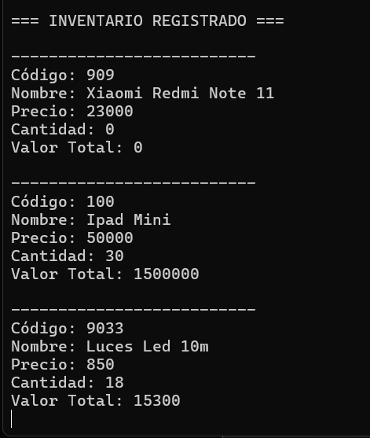
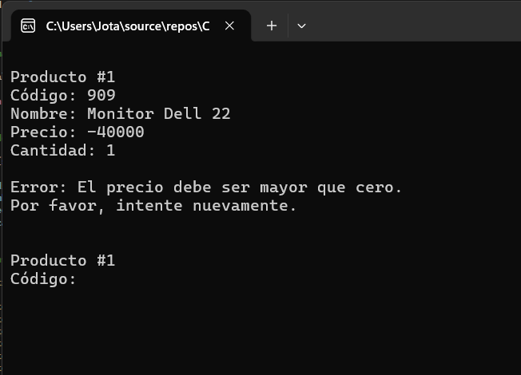
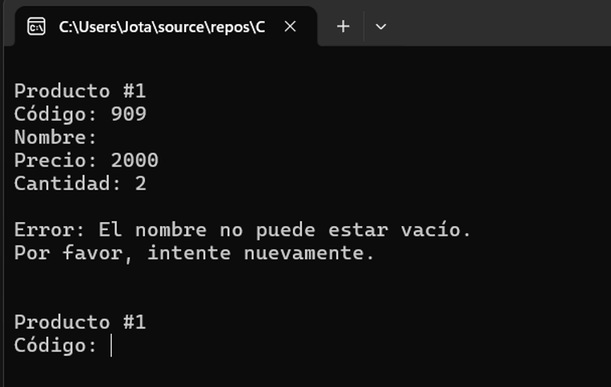
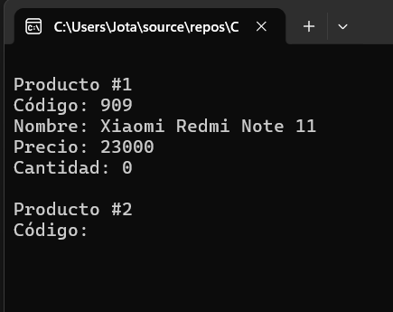

# Control de Inventario TecnoPunto

## Datos del Autor

- **Nombre:** Julio Evangelista
- **Matrícula:** 2026-1599
- **Universidad:** Universidad Central del Este (UCE)

## Descripción del Programa

Este programa fue desarrollado en C# (aplicación de consola) para la tienda TecnoPunto con el objetivo de registrar productos de manera confiable. Cada producto cuenta con un código, nombre, precio y cantidad. El sistema valida los datos ingresados y calcula automáticamente el valor total de cada producto en inventario.

El programa está organizado alrededor de la clase `Producto`, que contiene las propiedades `Codigo`, `Nombre`, `Precio`, `Cantidad` y `ValorTotal`, además del método `MostrarInfo()` para mostrar los datos del producto.

## Datos de Entrada

- Código del producto
- Nombre del producto
- Precio del producto
- Cantidad disponible

## Datos que Procesa

- Valida que el nombre no esté vacío.
- Valida que el precio sea mayor que cero.
- Valida que la cantidad no sea negativa (el cero es válido).
- Calcula Valor Total = Precio × Cantidad.

## Datos de Salida

Código, nombre, precio, cantidad y valor total del producto.

## Capturas de Ejecución

### Datos válidos

Inventario registrado con varios productos y su valor total calculado.

### Precio negativo

El sistema rechaza el precio y pide los datos nuevamente.

### Nombre vacío

El sistema rechaza el nombre vacío y pide los datos nuevamente.

### Cantidad cero

La cantidad cero es aceptada y el valor total del producto resulta 0.

## Repositorio GitHub

https://github.com/TU-USUARIO/evangelista-clases-objetos
